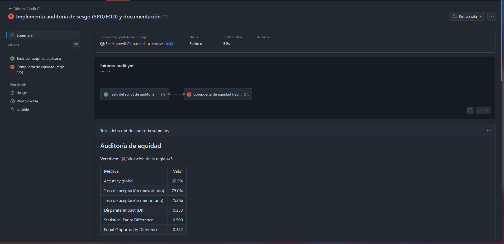
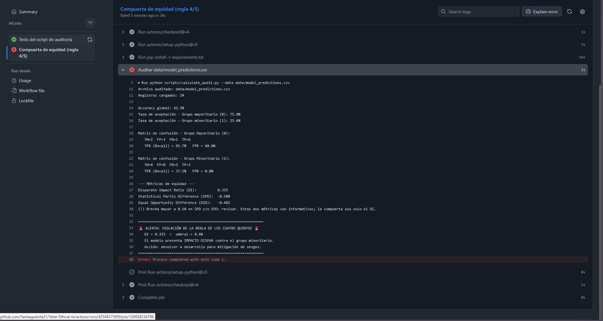
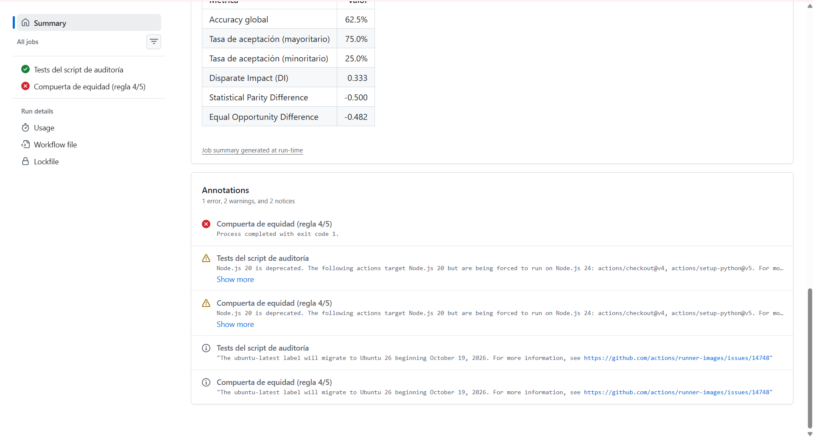
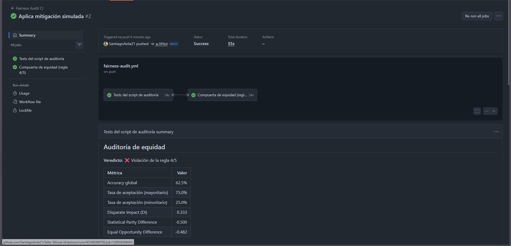
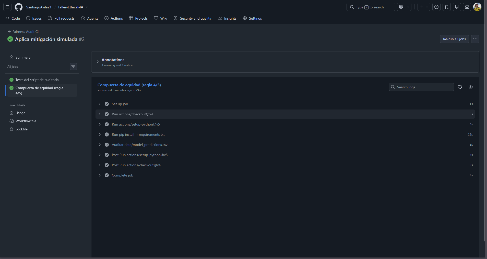

# Taller: Auditoría de Sesgo y Documentación de Modelos de IA

[](https://github.com/SantiagoAvila21/Taller-Ethical-IA/actions/workflows/fairness-audit.yml)

Taller práctico de 30 minutos. **No se entrena ningún modelo**: se audita uno ya
existente a partir de sus predicciones, se integra la auditoría en CI y se
documentan los resultados en una Model Card.

## 🎯 Objetivo

Al finalizar el taller serás capaz de:

1. Calcular métricas de equidad (**Disparate Impact**, **Statistical Parity Difference**,
   **Equal Opportunity Difference**) a partir de un CSV de predicciones.
2. Aplicar la **regla de los cuatro quintos** (DI ≥ 0.80) como criterio de aprobación.
3. Usar la auditoría como **quality gate en CI/CD** con GitHub Actions.
4. Documentar los hallazgos en una **Model Card**.

## 📁 Estructura

```
├── .github/workflows/fairness-audit.yml   # CI (no modificar)
├── data/model_predictions.csv             # Dataset a auditar
├── scripts/calculate_audit.py             # Script con 2 TODO por implementar
├── tests/                                 # Tests del script + datasets de referencia
├── MODEL_CARD_TEMPLATE.md                 # Plantilla de la Model Card
└── docs/img/                              # Aquí van tus capturas
```

## 🚀 Cómo empezar

Cada estudiante trabaja en **su propio repositorio público**, porque el CI de GitHub Actions
se ejecuta ahí. Clonar el repositorio del taller no basta: tu `git push` debe ir a tu repo, no al del docente.

### 1. Crea tu repositorio vacío en GitHub

1. Entra a <https://github.com/new>.
2. Nómbralo, por ejemplo, `bias-audit-workshop`.
3. Selecciona visibilidad **Public**.
4. **No marques** "Add a README", ".gitignore" ni "license". El repo debe quedar vacío.
5. Pulsa **Create repository**.

### 2. Clona el taller y apunta al repo que creaste

```bash
git clone https://github.com/<USUARIO_DOCENTE>/<REPO_DEL_TALLER>.git bias-audit-workshop
cd bias-audit-workshop

git remote set-url origin https://github.com/<TU_USUARIO>/<TU_REPO>.git
git branch -M main
git push -u origin main
```

Verifica que apuntas a tu repo y no al del docente:

```bash
git remote -v      # debe mostrar TU usuario, no el del docente
```

### 3. Comprueba que el CI está activo

1. Abre la pestaña **Actions** de tu repositorio.
2. Debe aparecer un run de **Fairness Audit CI** disparado por tu primer push.
3. Si ves un botón verde _"I understand my workflows, go ahead and enable them"_, púlsalo y relanza con **Run workflow**.

> Este primer run es **esperado**: `unit-tests` ✅ (con 2 tests _skipped_) y
> `fairness-gate` ❌. El modelo es sesgado a propósito; no es un error tuyo.

### 4. Actualiza el badge

Reemplaza `<USUARIO>/<REPO>` en la primera línea de este README por los tuyos.

### 5. Instala las dependencias (Python 3.9+)

```bash
python -m venv .venv
source .venv/bin/activate          # Windows: .venv\Scripts\activate
pip install -r requirements-dev.txt
```

## ▶️ Ejecución

```bash
python scripts/calculate_audit.py                    # audita data/model_predictions.csv
python scripts/calculate_audit.py --data <otro.csv>  # audita otro archivo
pytest -v                                            # tests del script
echo $?                                              # 0 = aprueba, 1 = viola la regla 4/5
```

---

## 📝 Pasos del taller

### Paso 1. Ejecuta el script tal como está

Corre el script sin modificar nada. Las métricas SPD y EOD deben aparecer como `PENDIENTE`.

**Evidencia 1: salida en consola (TODOs pendientes):**

```
$ python scripts/calculate_audit.py
Archivo auditado: data/model_predictions.csv
Registros cargados: 24

Accuracy global: 62.5%
Tasa de aceptación - Grupo mayoritario (0): 75.0%
Tasa de aceptación - Grupo minoritario (1): 25.0%

Matriz de confusión - Grupo Mayoritario (0):
   TN=2  FP=3  FN=1  TP=6
   TPR (Recall) = 85.7%   FPR = 60.0%

Matriz de confusión - Grupo Minoritario (1):
   TN=4  FP=0  FN=5  TP=3
   TPR (Recall) = 37.5%   FPR = 0.0%

--- Métricas de equidad ---
Disparate Impact Ratio (DI):          0.333
Statistical Parity Difference (SPD):  PENDIENTE (TODO 2)
Equal Opportunity Difference (EOD):   PENDIENTE (TODO 1)

============================================================
🚨 ALERTA: VIOLACIÓN DE LA REGLA DE LOS CUATRO QUINTOS 🚨
   DI = 0.333  <  umbral = 0.80
   El modelo presenta IMPACTO DISPAR contra el grupo minoritario.
   Acción: devolver a desarrollo para mitigación de sesgos.
============================================================
$ echo $?
1
```

### Paso 2. Implementa los TODO

En `scripts/calculate_audit.py` implementa:

- **TODO 1**: `equal_opportunity_difference` (TPR_min − TPR_maj)
- **TODO 2**: `statistical_parity_difference` (rate_min − rate_maj)

Verifica con `pytest -v`: los tests de SPD y EOD deben pasar de _skipped_ a _passed_.

**Evidencia 2: salida de `pytest -v` con TODOs implementados:**

```
$ pytest -v
============================= test session starts ==============================
platform linux -- Python 3.10.21, pytest-9.2.0, pluggy-1.7.0
rootdir: /home/santy/Documentos/espIngSoftware/Ingenieria de Software I/Taller-Ethical-IA
collecting ... collected 6 items

tests/test_audit.py::test_selection_rates_biased PASSED                  [ 16%]
tests/test_audit.py::test_disparate_impact_biased PASSED                 [ 33%]
tests/test_audit.py::test_spd_and_eod_biased PASSED                      [ 50%]
tests/test_audit.py::test_zero_majority_rate_raises PASSED               [ 66%]
tests/test_audit.py::test_exit_code_is_1_for_biased_model PASSED         [ 83%]
tests/test_audit.py::test_exit_code_is_0_for_fair_model PASSED           [100%]

============================== 6 passed in 2.25s ===============================
```

**Evidencia 3: salida en consola sobre el dataset sesgado (TODOs implementados):**

```
$ python scripts/calculate_audit.py
Archivo auditado: data/model_predictions.csv
Registros cargados: 24

Accuracy global: 62.5%
Tasa de aceptación - Grupo mayoritario (0): 75.0%
Tasa de aceptación - Grupo minoritario (1): 25.0%

Matriz de confusión - Grupo Mayoritario (0):
   TN=2  FP=3  FN=1  TP=6
   TPR (Recall) = 85.7%   FPR = 60.0%

Matriz de confusión - Grupo Minoritario (1):
   TN=4  FP=0  FN=5  TP=3
   TPR (Recall) = 37.5%   FPR = 0.0%

--- Métricas de equidad ---
Disparate Impact Ratio (DI):          0.333
Statistical Parity Difference (SPD):  -0.500
Equal Opportunity Difference (EOD):   -0.482
(!) Brecha mayor a 0.10 en SPD y/o EOD: revisar. Estas dos métricas son informativas; la compuerta usa solo el DI.

============================================================
🚨 ALERTA: VIOLACIÓN DE LA REGLA DE LOS CUATRO QUINTOS 🚨
   DI = 0.333  <  umbral = 0.80
   El modelo presenta IMPACTO DISPAR contra el grupo minoritario.
   Acción: devolver a desarrollo para mitigación de sesgos.
============================================================
$ echo $?
1
```

### Paso 3. Primer push: la compuerta debe fallar

```bash
git add . && git commit -m "Implementa SPD y EOD" && git push
```

Ve a la pestaña **Actions** de tu repositorio.

> **¿Por qué hay un check en rojo?** El script no está roto. Detecta que el _modelo_
> es sesgado y devuelve `exit 1`. Eso es exactamente lo que debe hacer un quality gate.

| #   | Captura                   | Guárdala como                    | Qué debe verse                        |
| --- | ------------------------- | -------------------------------- | ------------------------------------- |
| 1   | Resumen del workflow      | `docs/img/ci-1-gate-rojo.png`    | `unit-tests` ✅ y `fairness-gate` ❌  |
| 2   | Log del job fallido       | `docs/img/ci-2-log-alerta.png`   | Mensaje de violación y el valor de DI |
| 3   | Pestaña _Summary_ del run | `docs/img/ci-3-summary-rojo.png` | Tabla con DI, SPD y EOD               |





### Paso 4. Mitigación simulada

Simula que el equipo de desarrollo corrigió el modelo (por ejemplo, ajustando el umbral de decisión del grupo minoritario):

```bash
cp tests/fixtures/fair_predictions.csv data/model_predictions.csv
```

**Evidencia 4: salida en consola tras la mitigación:**

```
$ cp tests/fixtures/fair_predictions.csv data/model_predictions.csv
$ python scripts/calculate_audit.py
Archivo auditado: data/model_predictions.csv
Registros cargados: 24

Accuracy global: 75.0%
Tasa de aceptación - Grupo mayoritario (0): 75.0%
Tasa de aceptación - Grupo minoritario (1): 66.7%

Matriz de confusión - Grupo Mayoritario (0):
   TN=2  FP=3  FN=1  TP=6
   TPR (Recall) = 85.7%   FPR = 60.0%

Matriz de confusión - Grupo Minoritario (1):
   TN=3  FP=1  FN=1  TP=7
   TPR (Recall) = 87.5%   FPR = 25.0%

--- Métricas de equidad ---
Disparate Impact Ratio (DI):          0.889
Statistical Parity Difference (SPD):  -0.083
Equal Opportunity Difference (EOD):   +0.018

============================================================
✅ APROBADO: el modelo cumple la regla de los cuatro quintos.
   DI = 0.889  >=  umbral = 0.80
============================================================
$ echo $?
0
```

### Paso 5. Segundo push: la compuerta debe pasar

```bash
git add . && git commit -m "Aplica mitigación simulada" && git push
```

| #   | Captura                   | Guárdala como                     | Qué debe verse      |
| --- | ------------------------- | --------------------------------- | ------------------- |
| 4   | Resumen del workflow      | `docs/img/ci-4-gate-verde.png`    | Ambos jobs ✅       |
| 5   | Pestaña _Summary_ del run | `docs/img/ci-5-summary-verde.png` | Tabla con DI ≥ 0.80 |




---

## 🧠 Reflexión

### A. Resultados

Completa con los valores de tu ejecución.

| Métrica                     | Dataset sesgado | Tras mitigación |
| --------------------------- | --------------- | --------------- |
| Accuracy global             | 62,5 %          | 75,0 %          |
| Tasa de aceptación, grupo 0 | 75,0 %          | 75,0 %          |
| Tasa de aceptación, grupo 1 | 25,0 %          | 66,7 %          |
| TPR, grupo 0                | 85,7 %          | 85,7 %          |
| TPR, grupo 1                | 37,5 %          | 87,5 %          |
| FPR, grupo 0                | 60,0 %          | 60,0 %          |
| FPR, grupo 1                | 0,0 %           | 25,0 %          |
| **Disparate Impact (DI)**   | 0,333           | 0,889           |
| **SPD**                     | −0,500          | −0,083          |
| **EOD**                     | −0,482          | +0,018          |
| ¿Pasa la regla 4/5?         | ☐ Sí ☑ No       | ☑ Sí ☐ No       |

Muestra el cálculo manual de las tres métricas del dataset sesgado:

```
DI  = 0,25 / 0,75 = 0,333
SPD = 0,25 − 0,75 = −0,500
EOD = 0,375 − 0,857 = −0,482
```

### B. Preguntas

**1. ¿La EOD coincide con la conclusión del DI? ¿Miden lo mismo? Justifica.**

> Sí coinciden en el veredicto (ambas señalan desventaja del grupo 1), pero **no miden lo mismo**. El DI (0,333) compara las tasas de aceptación globales; la EOD (−0,482) compara solo el TPR, es decir, la proporción de personas **realmente calificadas** que son aceptadas. Un modelo puede tener DI bajo por diferencias en la prevalencia y, aun así, tratar igual a los calificados; aquí no ocurre: ambas métricas confirman el sesgo.

**2. Calcula qué proporción de cada grupo está realmente calificada (`true_label = 1`). ¿La brecha de aceptación se explica por mérito?**

> Grupo 0: 7/12 = **58,3 %** calificados. Grupo 1: 8/12 = **66,7 %** calificados. El grupo minoritario está **más** calificado, pero se le acepta menos (25 % vs. 75 %). Por tanto, **la brecha no se explica por mérito**; es discriminación del modelo.

**3. ¿Cuántas personas calificadas del grupo 1 fueron rechazadas (FN)? ¿Qué implica en un caso real?**

> **5 personas calificadas** del grupo 1 (FN = 5). En un caso real implicaría negar oportunidades (empleo, crédito, admisión) a personas aptas por pertenecer a un grupo, con daño económico y legal, y posible discriminación ilegal.

**4. Compara el FPR de ambos grupos. ¿Qué dice sobre los estándares que aplica el modelo a cada uno?**

> FPR grupo 0 = **60 %** (3 de 5 no calificados aceptados) frente a FPR grupo 1 = **0 %** (0 de 4). El modelo aplica un **estándar más estricto al grupo minoritario** y es más permisivo con los no calificados del grupo mayoritario: doble vara.

**5. El accuracy global puede verse aceptable aunque el modelo sea inequitativo. ¿Por qué ocurre?**

> Porque el accuracy es un promedio que oculta las diferencias entre grupos: si el grupo mayoritario domina la muestra, un buen desempeño en él compensa el mal desempeño en el minoritario. Además, los errores (FP y FN) pueden "compensarse" en el total sin que las tasas por grupo sean justas.

**6. El dataset tiene solo 12 registros por grupo. ¿Qué limitaciones tiene esta auditoría?**

> Muestra muy pequeña: alta varianza e intervalos de confianza amplios; un solo caso mueve mucho las métricas (p. ej. un FN más cambia el TPR drásticamente). Solo se audita un atributo protegido, sin análisis interseccional, y no se puede generalizar a toda la población.

**7. Propón dos mitigaciones técnicas reales (no la simulada) y un riesgo de cada una.**

> - **Ajuste de umbrales por grupo (post-procesamiento, p. ej. igualdad de oportunidades):** reduce la brecha de TPR; riesgo: usar el grupo protegido de forma explícita puede ser legal o éticamente cuestionable y afectar la precisión.
> - **Reponderación/remuestreo del entrenamiento o restricciones de equidad en proceso (p. ej. Fairlearn `ExponentiatedGradient`):** corrige el sesgo en origen; riesgo: exige reentrenar y acceder a los datos, puede degradar el rendimiento y no garantizar que la equidad se mantenga fuera de la muestra.

### C. Conclusión: auditoría vs. Model Card

Compara los valores que escribiste en tu `MODEL_CARD.md` antes de ejecutar el script
(tus hipótesis) con los obtenidos en la auditoría.

_Las cifras de "Hipótesis (antes)" son estimaciones razonables hechas sin ejecutar el
script; contrástalas con las tuyas si registraste otras._

| Métrica                     | Hipótesis (antes) | Obtenido (auditoría) | ¿Coincide? |
| --------------------------- | ----------------- | -------------------- | ---------- |
| Accuracy global             | ≈ 85 %            | 62,5 %               | No         |
| Tasa de aprobación, grupo 0 | ≈ 70 %            | 75,0 %               | Aprox.     |
| Tasa de aprobación, grupo 1 | ≈ 60 %            | 25,0 %               | No         |
| Disparate Impact            | ≈ 0,86            | 0,333                | No         |

**Conclusión (máx. 5 líneas):** ¿Qué te enseña esta comparación sobre llenar una Model Card con estimaciones frente a datos reales? ¿Es apto el modelo original para despliegue?

> Las estimaciones subestimaron gravemente el sesgo: se suponía casi paridad (DI ≈ 0,86)
> cuando el dato real es 0,333. Una Model Card basada en intuiciones habría aprobado un
> modelo discriminatorio. La auditoría muestra que solo los datos reales permiten decidir.
> **El modelo original no es apto para despliegue**: viola la regla 4/5 y debe volver a
> desarrollo para mitigación.

---

## 📋 Model Card

1. Copia la plantilla: `cp MODEL_CARD_TEMPLATE.md MODEL_CARD.md`
2. Complétala con los resultados **reales** de tu auditoría sobre el dataset sesgado.
3. Verifica que la "Conclusión de la Auditoría" sea coherente con DI, SPD y EOD.

## ✅ Checklist de entrega

- [x] TODO 1 y TODO 2 implementados; `pytest -v` sin _skipped_ ni fallos
- [x] Evidencias 1 a 4 (salidas de consola) pegadas arriba
- [x] 5 capturas de CI en `docs/img/` (3 en rojo, 2 en verde) y visibles en este README
- [x] Sección Reflexión completa (A, B y C)
- [x] `MODEL_CARD.md` completada
- [ ] Repositorio compartido con el docente

## 🧮 Rúbrica sugerida

| Criterio                                               | Puntos |
| ------------------------------------------------------ | ------ |
| Implementación correcta de SPD y EOD (tests en verde)  | 25     |
| Evidencias de CI (rojo y verde, con capturas legibles) | 25     |
| Reflexión: interpretación correcta de las métricas     | 25     |
| Model Card completa y coherente con la auditoría       | 25     |
